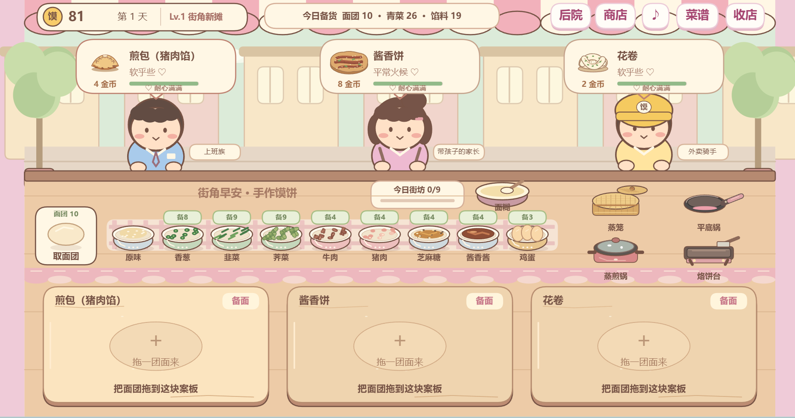
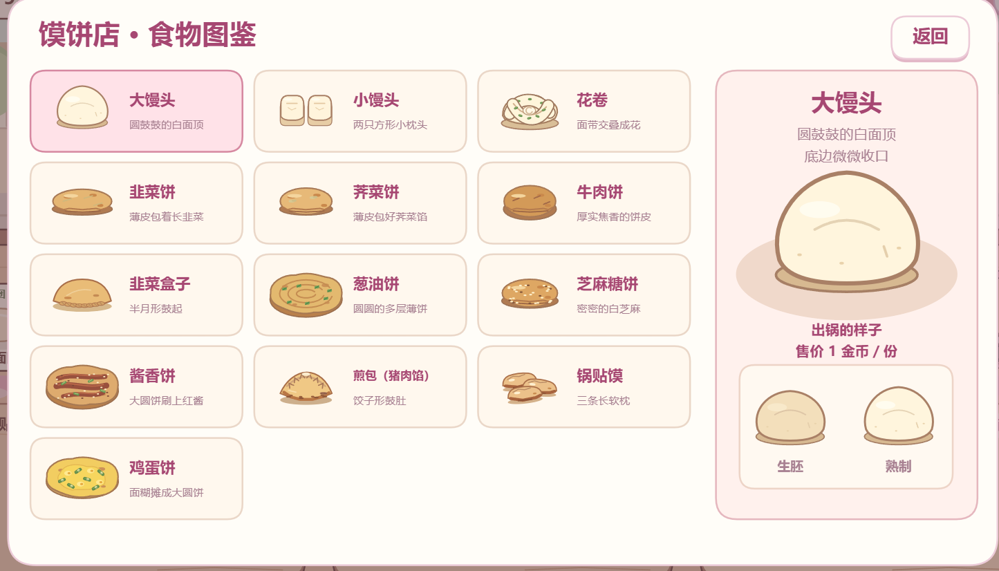

# 馍饼店 · 横屏经营小游戏（在线试玩）

以中国早点摊为主题的经营小游戏原型。三位顾客围在街角小摊前，玩家在三块案板之间并行揉面、加馅、塑形、掌握火候、切饼，卖出收入可以升级厨具，后院还有一片可以自己种麦子和蔬菜的田园。

画面、食物、人物与厨具全部由 Canvas 代码绘制，不依赖任何网络图片、外部服务或第三方依赖。

## 在线试玩

**<https://li2382187997.github.io/mobing-shop-demo/>**

电脑用鼠标按住拖动，手机用手指划动，横屏体验最佳（竖屏会自动旋转画面）。天数、金币、备货与厨具升级等进度保存在浏览器本地。

## 玩法概览

- 13 道菜品、4 类厨具（蒸笼 / 平底锅 / 蒸煎锅 / 烙饼台）、16 位街坊顾客，台面同时挂 3 份订单。
- 部分饼需要翻面，出锅后的大圆饼要用刀切块；韭菜饼、芝麻糖饼等是封口完整的圆饼。
- 后院田园：12 株小麦、8 处菜地，可逐株收割、复种、浇水；作物在游戏运行时持续生长，进度实时保存。
- 加工链：收麦穗 → 石磨磨粉 → 和面盆加水揉面 → 案板切菜，再到小商店采购肉、蛋、酱等辅料。
- 每天收店后用收入升级厨具，下一天烹饪更快；没有催单倒计时，可以随时收店。

## 技术实现

| 项 | 说明 |
|---|---|
| 渲染 | 原生 Canvas 2D，食物与人物造型全部由代码绘制，无任何图片素材 |
| 形态 | 单文件 HTML，约 149 KB，双击即可在浏览器打开，无需服务器 |
| 代码结构 | 玩法引擎、界面交互、食物绘制、细节动效、田园几何五个模块分层 |
| 测试 | 40 个单元测试文件，仅依赖 `node:assert`，核心逻辑可在无浏览器环境下回归 |

## 说明

这是一版可玩的核心循环。正式版本还需要补充更多角色动画、音效与街坊故事。

本仓库只发布构建后的试玩页面，完整源码暂未公开，可在面试中演示。
